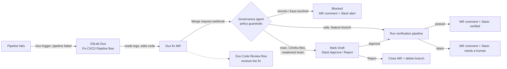

# Self-Healing CI/CD with Governance

**GitLab Duo fixes failing pipelines. This agent decides whether that fix is safe, asks a human when it isn't, and proves it works.**

Built for the GitLab Transcend Hackathon, *Life After Code*. License: MIT.

When a pipeline fails, a **GitLab Duo Agent Platform flow** (the *Fix CI/CD Pipeline* flow, started by a *pipeline failed* trigger) reads the job log, finds the root cause and opens a fix merge request. This service is the **governance layer** around that agent. It inspects every Duo fix MR, enforces guardrails, routes risky changes to a human in Slack, runs a verification pipeline and reports the outcome. Every decision is left as a comment on the MR, which becomes the audit trail.

Autonomy level: **supervised**. Safe fixes on feature branches are verified automatically. Fixes for production, CI or infrastructure files, or anything that weakens tests wait for a human. Nothing is ever merged automatically.



## DevSecOps stages covered

| Stage | What happens |
|---|---|
| **Verify** | A failed pipeline triggers Duo; the agent runs a verification pipeline on the fix |
| **Create** | Duo's Fix CI/CD Pipeline flow writes the fix and opens the MR |
| **Review** | Duo's Code Review flow reviews the fix MR |
| **Secure / Govern** | Guardrails block changes to secrets and keys, flag weakened tests and `allow_failure`, and gate production branches |
| **Plan / Collaborate** | Slack approval cards; every decision is commented on the MR |
| **Monitor** | Structured JSON event logs, ready for Cloud Logging log-based metrics and alerts (`deploy/observability.sh`) |

## Guardrails (`app/policy.py`)

| Duo's fix… | Decision |
|---|---|
| touches `*.pem`, `*.key`, `.git/` or similar | **Blocked**: labelled `self-heal::blocked`, with a comment and a Slack alert |
| changes too many files or is too large | **Blocked** |
| targets `main`, `master`, `production` or `release/*` | **Human approval** in Slack; the MR is marked Draft until approved |
| touches `.gitlab-ci.yml`, `Dockerfile`, Terraform, `deploy/`, `k8s/`, `helm/` | **Human approval** |
| adds skip or xfail markers, removes assertions, or adds `allow_failure: true` | **Human approval** (stops "make CI green" cheats) |
| none of the above | **Auto-verified**: the verification pipeline runs straight away |

## How it was demonstrated

On the [demo project](https://gitlab.com/praveen-group8045443/selfheal-cicd):

1. A bug was planted on `feature/duo-demo` (`percent / 10` instead of `/ 100`), and the `unit` job failed.
2. The Duo trigger started the Fix CI/CD Pipeline flow. It opened **MR !4** with the correct one-line fix in `src/pricing.py` and left the test unchanged.
3. The governance agent labelled it `self-heal` and `duo-flow`, found no policy concerns, and started a verification pipeline.
4. The pipeline passed. The agent commented *"Pipeline passed with the Duo fix"* and posted to Slack.
5. On `main`, the same kind of fix was held as a Draft with a Slack **Approve / Reject** card, and ran only after a human clicked Approve (MR !2).

## Setup

### 1. GitLab Duo flow
1. Group → **Settings → GitLab Duo**: tick **Allow flow execution**, **Allow foundational flows** and **Fix CI/CD Pipeline** (and **Code Review**).
2. Project → **AI → Flows → Fix CI/CD Pipeline → Enable**.
3. Project → **AI → Triggers → New trigger**: flow **Fix CI/CD Pipeline**, condition **Pipeline events → Failed**.

### 2. Governance agent
```bash
python -m venv .venv && source .venv/bin/activate
pip install -r requirements-dev.txt
pytest -q                     # 47 tests
cp .env.example .env          # GITLAB_TOKEN, GITLAB_WEBHOOK_SECRET, Slack values, HEALER=duo
uvicorn app.main:app --port 8080
cloudflared tunnel --url http://localhost:8080   # or deploy (below)
```
- GitLab token: personal or project access token with `api` and `write_repository`.
- Project → **Settings → Webhooks**: URL `https://<agent>/webhooks/gitlab`, secret = `GITLAB_WEBHOOK_SECRET`, triggers **Pipeline events** and **Merge request events**.

### 3. Slack approvals
1. Create an app at api.slack.com/apps with the bot scope `chat:write`, and install it.
2. **Interactivity** Request URL: `https://<agent>/slack/interactions`.
3. Set `SLACK_BOT_TOKEN`, `SLACK_SIGNING_SECRET` and `SLACK_CHANNEL_ID`, and invite the bot to the channel. Optionally restrict approvers with `SLACK_APPROVER_IDS`.

## Standalone mode (`HEALER=agent`)

The service can also diagnose failures itself, without Duo. It parses the logs, runs a tool-use loop with an LLM (Claude via the Anthropic API or Vertex AI, Gemini, or a free `mock`), and pushes its own `selfheal/…` fix branch. That mode adds:
- one retry for flaky runner and network failures (no LLM call)
- up to `MAX_ATTEMPTS` repair attempts, then escalation
- stateless incident tracking in commit trailers (`Self-Heal-Attempt`, `Self-Heal-Target`)

## Project layout

```
app/
  main.py            FastAPI: /webhooks/gitlab, /slack/interactions, /healthz
  orchestrator.py    governance of Duo fix MRs; standalone healing loop; approvals
  policy.py          guardrails: blockers and approval triggers
  approval/slack.py  Block Kit approval card + signature verification
  gitlab_client.py   the small slice of the GitLab API the agent uses
  llm.py             standalone-mode diagnosers (Claude, Gemini, mock)
  log_parser.py      log cleanup, error windowing, failure classification
  observability.py   Cloud Logging JSON events
deploy/              Cloud Run deploy script + log-based metrics and alerts
examples/demo-repo   the demo project with the planted bug
scripts/             local diagnosis try-out, webhook replay, model listing
tests/               47 tests with fakes for GitLab, the LLM and Slack
```

## Deploy to Google Cloud Run (optional)

```bash
PROJECT_ID=my-proj REGION=us-central1 ./deploy/cloudrun.sh
PROJECT_ID=my-proj NOTIFICATION_CHANNEL=projects/my-proj/notificationChannels/123 ./deploy/observability.sh
```

## Roadmap

- A custom Duo flow that writes its root cause in a structured form the governance layer can score
- Opening a GitLab issue when a fix fails verification twice (the Plan stage)
- Resolve SAST Vulnerability flow under the same guardrails
- Queue-backed processing (Cloud Tasks) and a permanent deployment
