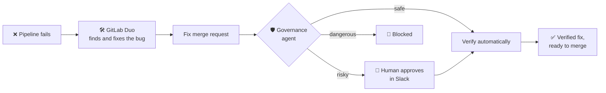

# Self-Healing CI/CD with Governance

**GitLab Duo fixes your broken pipelines. This agent makes sure those fixes are safe before anyone relies on them.**

*Built for the GitLab Transcend Hackathon, "Life After Code". MIT License.*

---

## The problem

AI agents can now repair a failing pipeline on their own. That raises a new question: **how do you trust a code change no person wrote?** An agent under pressure to make CI green may skip a test, touch a secret, or push straight to production. Teams need autonomy *and* control.

## The solution

Two agents, each with a clear job:

| | Role | What it does |
|---|---|---|
| 🛠️ **GitLab Duo** (Fix CI/CD Pipeline flow) | **The fixer** | A failed pipeline triggers it automatically. It reads the job log, finds the root cause, edits the code and opens a merge request. |
| 🛡️ **Governance agent** (this repo) | **The guardian** | Checks every Duo fix against safety rules, sends risky ones to a human in Slack, runs a verification pipeline, and records every decision on the MR. |

**Autonomy level: supervised.** Safe fixes go ahead automatically. Risky fixes wait for a human. Nothing is ever merged without a person.

## How it works



## The safety rules

| If Duo's fix… | Then |
|---|---|
| is a normal code change on a feature branch | ✅ **Auto-verified**: a test pipeline runs right away |
| targets `main` or a release branch | 👤 **Human approval in Slack** first |
| changes CI, Docker or infrastructure files | 👤 **Human approval** |
| skips or weakens tests to make CI green | 👤 **Human approval** |
| touches secrets or keys | 🛑 **Blocked** |

## See it in action

Everything below happened on the public [demo project](https://gitlab.com/praveen-group8045443/selfheal-cicd):

- **MR !4: automatic path.** A planted bug broke the pipeline. Duo fixed it on its own, the governance agent approved and verified it, and the test pipeline passed. ✅
- **MR !2: human-in-the-loop path.** A fix aimed at `main` was held as a Draft until a person clicked **Approve** in Slack. Only then did it run and pass. ✅

## DevSecOps lifecycle coverage

**Verify** (failed pipelines trigger healing, fixes are re-tested) · **Create** (Duo writes the fix) · **Review** (Duo Code Review flow) · **Secure & Govern** (guardrails, approval gates, audit trail) · **Collaborate** (Slack approvals) · **Monitor** (structured event logs for Cloud Logging)

## Built with

- **GitLab Duo Agent Platform:** Fix CI/CD Pipeline flow, Code Review flow, pipeline-event triggers
- **Python + FastAPI:** the governance agent (47 automated tests)
- **Slack:** interactive approval cards
- **Google Cloud-ready:** Cloud Run deploy script and Cloud Logging metrics

## Quick start

```bash
pip install -r requirements-dev.txt
pytest -q                          # 47 tests
cp .env.example .env               # add your GitLab and Slack settings, HEALER=duo
uvicorn app.main:app --port 8080
```

Full setup (Duo flow and trigger, webhook, Slack app, Cloud Run): **[docs/SETUP.md](docs/SETUP.md)**

## What's next

- A custom Duo flow that opens an issue when a fix can't be verified
- The same guardrails for Duo's security-fix flows
- Always-on hosting on Google Cloud Run
